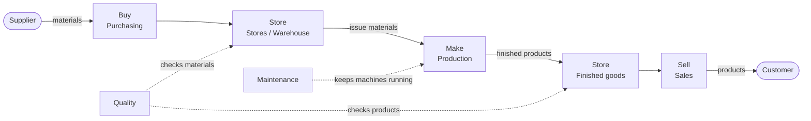
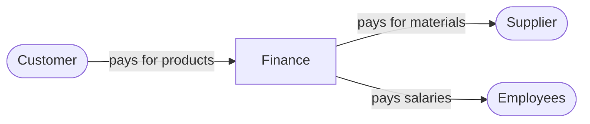

# How a Company Works

**Project 1 of my ERP & Data Analyst learning journey**

Before learning SAP S/4HANA, SQL and Power BI, I'm learning how a company works every day. Every SAP module copies a real department, so understanding the business first makes the software much easier to learn.

## The departments of a company

| Department | What it does | Example in a manufacturing plant | SAP module (I'll learn later) |
|---|---|---|---|
| **Purchasing** | Buys materials and services from suppliers | Orders lubricant oil and spare parts | MM (Materials Management) |
| **Stores / Warehouse** | Receives, stores and issues materials | Receives a delivery and issues items to workers | MM (Inventory), EWM |
| **Production** | Turns materials into finished products | Runs the machines that make the product | PP (Production Planning) |
| **Sales** | Sells products to customers | Takes customer orders and arranges delivery | SD (Sales and Distribution) |
| **Finance** | Records all money in and out | Pays supplier invoices and collects customer payments | FI (Financial Accounting) |
| **Controlling** | Tracks costs for each department and product | Shows what each machine or department costs | CO (Controlling) |
| **Maintenance** | Keeps machines running | Services machines and fixes breakdowns | PM (Plant Maintenance) |
| **Quality** | Checks materials and products | Inspects goods before they are used or sold | QM (Quality Management) |
| **Human Resources** | Hires, pays and trains people | Manages attendance, salaries and training | SAP SuccessFactors |

## The flow: Buy → Store → Make → Sell

1. **Buy:** Purchasing orders materials from a supplier.
2. **Store:** Stores receives the materials, checks them and keeps them safe until needed.
3. **Make:** Production takes materials from stores and turns them into finished products.
4. **Store again:** Finished products go back into stores until a customer orders them.
5. **Sell:** Sales delivers the products to the customer.

Along the way, Finance pays the supplier and collects money from the customer, Maintenance keeps the machines running, and Quality checks materials and products.

## How money flows

Goods move one way, and money moves the other way.

## What I learned

1. 
2. 
3. 

## How this connects to SAP S/4HANA

In SAP S/4HANA, each department works in its own module, but all modules share one system. When Stores receives goods, Purchasing sees the order is delivered and Finance sees the value of the stock go up, all at the same time.

*Next project: Excel inventory analysis (Project 2).*
